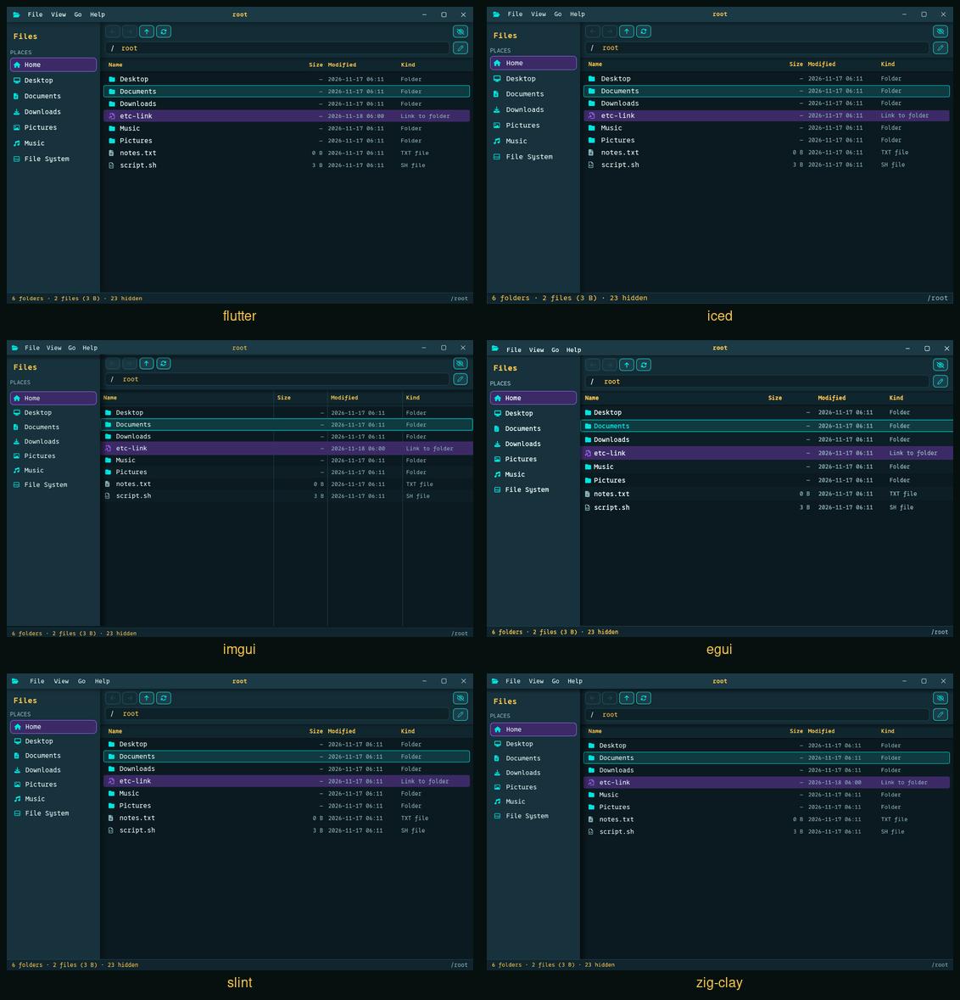

# filemanage — one file manager, six Linux GUI stacks

A deliberately small **file manager first draft** (list, navigate, history,
breadcrumbs, places, hidden-files toggle), built six times with six different
toolkits. The goal is to evaluate which stack works best for **friendly
desktop apps that make Linux system tasks easier for new and non-power users**.

All apps share the same feature set, architecture (DDD + hexagonal layers +
MVVM) and visual language: **aqua** primary, **purple** and **gold** accents,
**0xProto Nerd Font**. Any difference you see or feel comes from the toolkit.



| App | Stack | Paradigm | Folder |
|---|---|---|---|
| **Flutter** | Dart 3.14 · Flutter (Material, `provider`) | Declarative, retained | [`apps/dart-flutter`](apps/dart-flutter) |
| **iced** | Rust · iced 0.14 (wgpu) | The Elm Architecture | [`apps/rust-iced`](apps/rust-iced) |
| **Dear ImGui** | C++23 · Dear ImGui 1.93 · GLFW · OpenGL 3 | Immediate mode | [`apps/cpp-imgui`](apps/cpp-imgui) |
| **egui** | Rust · egui/eframe 0.37 (glow) | Immediate mode | [`apps/rust-egui`](apps/rust-egui) |
| **Slint** | Rust · Slint 1.19 (`.slint` markup) | Declarative, compiled | [`apps/rust-slint`](apps/rust-slint) |
| **Zig + Clay** | Zig 0.17 · Clay 0.14 (zclay) · raylib 6.2 | Immediate-mode layout | [`apps/zig-clay`](apps/zig-clay) |

## Repository layout

```
filemanage/
├── design/tokens.json        single source of truth for colours, sizes, glyphs
├── assets/fonts/             0xProto Nerd Font (Regular/Bold/Italic) + OFL licence
├── docs/
│   ├── ARCHITECTURE.md       shared feature scope, layers, MVVM-per-paradigm, palette roles
│   ├── ELEVATION.md          depth/elevation change: cost and approach per stack
│   ├── CHROME.md             custom title bar, menus, location input: cost and pitfalls per stack
│   └── screenshots/
├── libs/rust/
│   ├── fm-core/              shared Rust domain + use cases + filesystem adapters
│   └── fm-ui-kit/            shared Rust tokens, Nerd Font glyphs, formatters
├── apps/
│   ├── dart-flutter/  rust-iced/  cpp-imgui/  rust-egui/  rust-slint/  zig-clay/
├── Cargo.toml                Cargo workspace for the three Rust apps
└── rustfmt.toml
```

Every app has its own README with its folder structure and stack-specific
notes. [docs/ARCHITECTURE.md](docs/ARCHITECTURE.md) explains the shared design.
[docs/ELEVATION.md](docs/ELEVATION.md) compares what it took to add depth
(elevation, shadows) to each stack. [docs/CHROME.md](docs/CHROME.md) compares
client-side decorations (custom title bar, menus, window controls), the
editable location bar and text input, including what each approach means on
Wayland/sway.

## Build & run

| App | Command | Needs |
|---|---|---|
| Flutter | `cd apps/dart-flutter && flutter run -d linux` | Flutter (stable), `clang cmake ninja-build libgtk-3-dev` |
| iced | `cargo run --release -p fm-iced` | Rust ≥ 1.88 |
| egui | `cargo run --release -p fm-egui` | Rust ≥ 1.88 |
| Slint | `cargo run --release -p fm-slint` | Rust ≥ 1.88, `libfontconfig1-dev` |
| Dear ImGui | `cd apps/cpp-imgui && cmake --preset release && cmake --build --preset release && ./build/release/fm_imgui` | GCC 13+/Clang 17+, CMake ≥ 3.25, Ninja, `libgl-dev` |
| Zig + Clay | `cd apps/zig-clay && zig build run -Doptimize=ReleaseSafe` | Zig 0.17.1 |

Rust apps on X11/Wayland also need the usual `libxkbcommon-x11-0` /
`libwayland-client0` runtime libraries, which desktop distros already ship.

### Quality gates

| App | Lint / format | Tests |
|---|---|---|
| Rust (all) | `cargo clippy --workspace --all-targets` (pedantic, zero warnings), `cargo fmt` | `cargo test --workspace` → 23 tests (core, kit, iced update/keys, egui view model, Slint presenter) |
| Flutter | `flutter analyze` (strict casts/inference + extra lints, zero issues), `dart format` | `flutter test` → 15 tests (domain, view model with fakes, widget) |
| Dear ImGui | `-Wall -Wextra -Wpedantic -Wconversion … -Werror`, `.clang-format`, `.clang-tidy` | `ctest --preset debug` (doctest: domain, use case, fs adapter) |
| Zig | `zig fmt` | `zig build test` → 12 tests (domain, use case, fs adapter, formatters) |

## Evaluation

### Measurements

Release builds, measured on the same Linux machine (Xvfb with Mesa software
rendering, so absolute memory is higher than on a real GPU; compare them
relative to each other).

| | Flutter | iced | Dear ImGui | egui | Slint | Zig + Clay |
|---|---|---|---|---|---|---|
| Release artefact | 29 MB bundle (engine + ICU + AOT) | 19 MB | **1.4 MB** + 2.4 MB font file | 13 MB | 24 MB | 14 MB (ReleaseSafe) |
| Time to window | 0.34 s | 0.17 s | **0.06 s** | 0.12 s | 0.17 s | 0.12 s |
| Resident memory, idle home folder | 270 MB | 149 MB | **109 MB** | 113 MB | 138 MB | 126 MB |

The Rust and Zig binaries embed the Regular and Bold fonts (~5 MB). Rust
binaries are stripped, with thin LTO. Startup and memory were measured once each, as
an indication rather than a benchmark.

Lines of code (non-blank), app-specific only:

| | Flutter | iced | Dear ImGui | egui | Slint | Zig + Clay |
|---|---|---|---|---|---|---|
| Presentation + composition root | 1 227 | 883 | 1 221 | 784 | 405 Rust + 589 `.slint` | 1 058 |
| Domain + application + infrastructure | 444 | 626 (shared crate `fm-core`) | 567 | ← shared | ← shared | 582 |
| Separate test files | 237 | in-file `#[cfg(test)]` | 118 | in-file | in-file | in-file `test` blocks |

The Rust apps also share 210 lines of presentation helpers (`fm-ui-kit`).

### What it was like to build the same app six times

**Flutter**: *the most complete toolkit for end-user apps.* Text, scrolling,
virtualised lists, tooltips, focus, shortcuts (`Shortcuts`/`Actions`), theming
(`ThemeData` + `ThemeExtension`) and accessibility all come built in, and the
official architecture guide maps one-to-one onto MVVM. Hot reload and DevTools
make tuning visuals fast. Costs: the largest runtime and memory footprint, a
GTK-embedded engine on Linux, and some ecosystem churn (Material moved into the
separate `material_ui` package in this release). Desktop-integration packages
(D-Bus, polkit, portals) exist but are thinner than in Rust.

**iced**: *the cleanest architecture.* The Elm Architecture makes the app very
easy to reason about and to test: `update` is plain Rust and needs no window.
Async work fits naturally through `Task`. Rough edges: styling means writing
style closures per widget, hover on non-button widgets needs state, the widget
set is smaller (no built-in data table with selection), and accessibility and
IME support are still maturing. Best Rust option if you value correctness and
clarity.

**Dear ImGui**: *fast and tiny, but built for tools, not consumer apps.*
Getting an "app" look took the most manual work: custom draw-list rendering for
the sidebar, selection outlines, font-size conversion, and an event-driven loop
so the app doesn't burn CPU at idle. Input trickling forced extra care in that
loop. There's no accessibility, and native text input/IME is minimal. Excellent
for internal or debug tools; not recommended for apps aimed at new users.

**egui**: *the fastest path from zero to working UI.* Immediate mode with
sensible defaults, panels and `egui_extras` tables made this the shortest Rust
app. The view model stays toolkit-free, and egui ships AccessKit-based
accessibility. Visual customisation is coarse, mostly global `Visuals`, and
pixel-perfect layouts take workarounds (painting header bands on the layer
painter, for example). Great for utilities and admin tools.

**Slint**: *the most "designer-friendly" stack, and textbook MVVM.* The
`.slint` markup reads like a design file, the `BrowserViewModel` global is an
explicit binding contract, lists are virtualised, and the runtime is light. It
has accessibility support and a live-preview LSP. Quirks hit along the way:
`z` only orders siblings (tooltips need an overlay), `Text` clips wide Nerd
Font glyphs, `changed` handlers only watch local properties, and the generated
code needs `unsafe`. Check the licence options (GPLv3, the royalty-free
desktop licence, or commercial) for your distribution model. Strong runner-up,
especially if you want Rust plus a declarative UI.

**Zig + Clay**: *maximum control, minimum batteries.* Clay is a layout engine,
not a toolkit: tooltips, double-click detection, hover cursors, scroll
virtualisation and the glyph atlas were all hand-built. It's very fast, with
small binaries and explicit memory (arenas per frame and per listing). But
there is no accessibility, text input had to be hand-written (`TextField.zig`), raylib bakes a fixed glyph set
(non-Latin file names don't render), and Zig 0.16/0.17 API churn (`std.Io`,
package manager) adds friction. Interesting technology; not yet practical for
end-user apps.

### Recommendation for this project

For **friendly system apps for non-power users**, the deciding factors are
accessibility, text/IME and i18n quality, polished widgets, and long-term
maintainability:

1. **Flutter**: best end-user polish and accessibility out of the box, plus the fastest visual iteration. Pick it if a bigger runtime is acceptable.
2. **Slint**: closest to Flutter's productivity with a much lighter Rust runtime and a real MVVM contract. Pick it if footprint and Rust system crates (`zbus`, polkit, udisks) matter more.
3. **iced**: if you want pure Rust and the Elm Architecture, and can live with a younger widget and accessibility story.
4. **egui**: for internal or admin utilities.
5. **Dear ImGui / Zig + Clay**: for developer tools or experiments rather than apps for new users.
