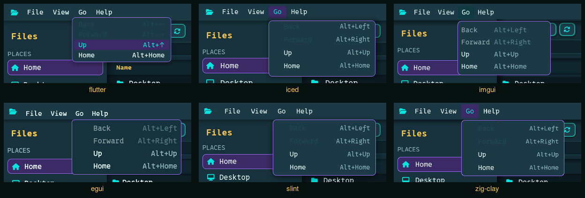
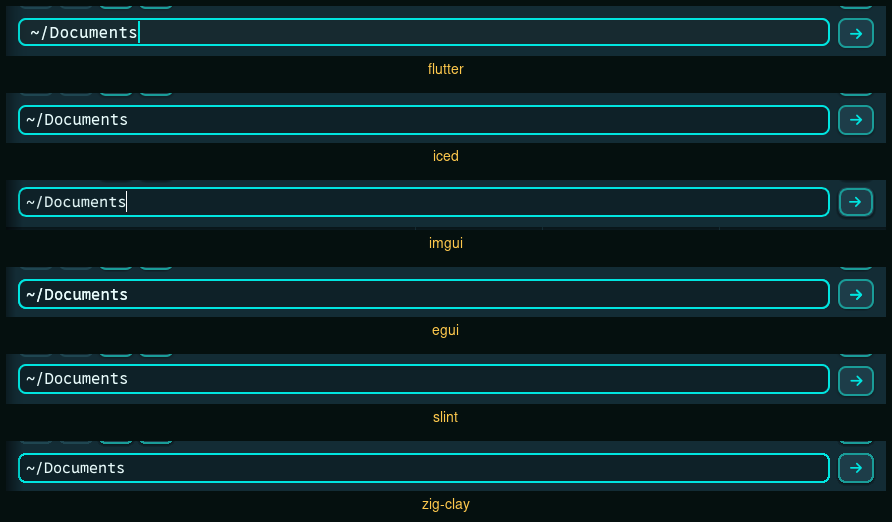

# Window chrome, menus and text input: what it took in each stack

This round added four things to all six apps:

1. **2px tool-button borders**, coloured by state (`#1A9C98` normal, purple
   hover, aqua pressed, dim disabled).
2. **Client-side decorations (CSD)**: the system title bar is gone. Each app
   draws its own title bar with **File / View / Go / Help** menus, the current
   folder as title, and **minimise / maximise / close**. Drag the empty area to
   move, double-click it to maximise, and grab any window edge to resize. Plus
   an **About** dialog.
3. **Location row**: the breadcrumbs moved under the action buttons, inside an
   inset field. Click the field, press the pencil button or **Ctrl+L** to type a
   path. `~`, relative paths and `..` work, **Enter** navigates and **Esc**
   cancels.
4. **iced tooltips** now render as styled bubbles (iced's default tooltip is
   bare floating text; it needs `.style()`, `.padding()` and `.gap()`).

New shortcuts everywhere: **Ctrl+L** open location, **Ctrl+Q** quit,
**Alt+Home** home. Menus, tokens and path resolution are shared in spirit:
`DirectoryPath::resolve_user_input` exists in each core with the same test
cases.

## How each stack did it

| | Window move / resize | Menus | Text input | Code touched* |
|---|---|---|---|---|
| **Flutter** | GTK runner: `gtk_window_set_decorated(FALSE)` plus a ~100-line native method channel (`gtk_window_begin_move_drag` / `begin_resize_drag`) | ✅ built in: `MenuBar`, `SubmenuButton`, `MenuItemButton`, `CheckboxMenuButton`, with shortcut labels | ✅ `TextField` | +897 −45 Dart (inflated by `dart format`), +102 C |
| **iced** | ✅ `.decorations(false)` + `window::drag`, `drag_resize`, `toggle_maximize` tasks (winit → compositor) | ❌ hand-built: `stack!` + `pin` + `opaque` overlay, with a click-catcher to close | ✅ `text_input` (+ `operation::focus` / `select_all`) | +735 −55 |
| **Dear ImGui** | ⚠️ GLFW can't hand a move/resize to the WM, so it's manual (position/size from pointer deltas) | ✅ built in: `BeginMenuBar`, `BeginMenu`, `MenuItem` (shortcut text, checkmarks) | ✅ `InputText` + `imgui_stdlib` | +704 −37 |
| **egui** | ✅ `with_decorations(false)` + `ViewportCommand::StartDrag` / `BeginResize` (winit → compositor) | ✅ built in: `MenuBar`, `menu_button`, `Button::shortcut_text`, `Modal` | ✅ `TextEdit` | +503 −67 (the smallest) |
| **Slint** | ✅ `no-frame: true` + Slint's window API; move/resize via the `unstable-winit-030` accessor (`drag_window`, `drag_resize_window`) | ⚠️ `PopupWindow` + a data model (`[MenuEntry]`) | ✅ `TextInput` | +640 −57 |
| **Zig + Clay** | ⚠️ manual, like ImGui (raylib sits on GLFW), plus raw GLFW calls | ❌ hand-built: Clay floating elements, hover/click logic, outside-click closing | ❌ **hand-written**: `TextField.zig` (UTF-8 caret, select-all, backspace/delete, arrows, Home/End, paste, unit-tested); the caret is placed with the renderer's font metrics | +950 −34 |

\* `git diff --numstat` for this round, app code only. The Rust apps also
share +175 lines in `fm-core` / `fm-ui-kit` (menu model, tokens, path
resolution).

### Pitfalls found along the way

- **Flutter**:
  - `window_manager` 0.7 now depends on an external C++ library fetched at
    build time, so a small native channel in the runner was the leaner
    choice.
  - Shortcuts closest to focus win: our screen-level Backspace / arrows /
    Enter bindings would have stolen keys from the `TextField`. Disabling
    those actions while typing lets the keys fall through.
  - `MenuStyle.minimumSize` from the theme only applies to the menu bar;
    dropdown items need their own width.
- **iced**:
  - There is no menu widget, so menus are overlays positioned with `pin`
    (0xProto being monospaced makes the dropdown x-offsets computable).
  - The modal backdrop must be `opaque`, or widgets underneath keep
    receiving hover and their tooltips show through the dialog.
  - `keyboard::listen` only reports unhandled keys. That's perfect for not
    triggering shortcuts while typing, but Escape inside the text input
    needed `event::listen_with`.
- **Dear ImGui**:
  - Dropdowns inherit the style active when they open (zero padding leaked
    in).
  - Shortcut hints use `TextDisabled`.
  - With keyboard nav off, Escape doesn't close menus without
    `ClosePopupsExceptModals` (internal API).
  - In 1.92.8, `AddRect`'s `thickness`/`flags` parameters swapped order.
- **egui**:
  - `consume_key` runs before widgets, so shortcuts must skip keys that
    `TextEdit` needs while typing.
  - `scope_builder` advances the parent cursor but `new_child` doesn't,
    which matters for overlaying crumbs on a clickable field.
- **Slint**:
  - **After `drag_window()` the window manager swallows the button release**,
    so Slint's pressed `TouchArea` kept its pointer grab and every later
    click started another drag. The fix is a *deferred* (next event-loop
    turn) synthetic `PointerReleased` + `PointerExited`.
  - `@children` can't be forwarded into a `PopupWindow`, hence data-driven
    menus.
  - Text clips Nerd Font glyphs again on the window controls.
- **Zig + Clay**:
  - Everything a toolkit normally provides had to be written:
    - menu open/close/hover-switch logic
    - outside-click handling
    - modal backdrop
    - the text field and its blinking caret
  - raylib caches window-relative pointer coordinates, so a manual window
    move overshot and compounded; the fix queries the embedded GLFW directly.
  - There is still no IME/composition, no click-to-place caret and no
    drag-to-select.

### What this means for a desktop shell on sway

- **Interactive move/resize must be compositor-driven on Wayland**
  (`xdg_toplevel.move` / `.resize`). Clients can't position their own
  windows there.
  - winit (iced, egui, Slint) and GTK (Flutter) do this, so their CSD works on
    sway.
  - The manual approach used by **Dear ImGui and Zig/raylib only works on
    X11**. GLFW has no API for a compositor-driven move, so on Wayland those
    two would need their own Wayland client code.
- **In a tiling compositor, CSD title bars mostly matter for floating
  windows.** For tiled windows you'd likely want server-side decorations via
  `xdg-decoration`, or none, with menus living elsewhere. Worth deciding at
  the DE level before investing heavily in per-app title bars.
- **Built-in widgets matter more than raw rendering here.**
  - Menus, modal dialogs and text input were free in Flutter, egui and Dear
    ImGui, mostly free in Slint, partly hand-built in iced, and entirely
    hand-built in Clay.
  - Text input is the expensive one: a production text field also needs
    IME, selection, clipboard, undo and accessibility. A toolkit that ships
    one saves the most.

## Verifying it

The window operations were checked under the Openbox window manager
(Xvfb has none, and move/maximise/resize are requests *to* a window manager).
All six passed the same scripted sequence: drag the title bar, maximise,
restore, resize from the bottom-right corner, close with ✕. The menus, a
tooltip, typing `~/Documents` + Enter, and the About dialog were exercised in
each app.
